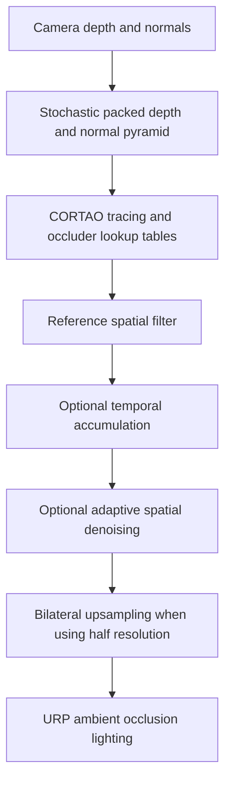

 *but manually tested over few days.. : )

# CORTAO for Unity URP

## Installation

### Unity Package Manager (recommended)

1. Open **Window > Package Manager**.
2. Click **+ > Install package from git URL** (the wording may vary by Unity version).
3. Paste the following URL and install the package:

```text
https://github.com/unitycoder/com.unitycoder.cortao.git
```

Git must be installed on your computer. This URL assumes that `package.json` is at the root of the repository.

Alternatively, add this entry to the `dependencies` object in your project's `Packages/manifest.json`:

```json
"com.unitycoder.cortao": "https://github.com/unitycoder/com.unitycoder.cortao.git"
```

### Info

A free Unity integration of **Circular Occluder Ray-Traced Ambient Occlusion (CORTAO)**, a screen-space ambient occlusion technique developed by Daniel Isheden.
This package brings the original CORTAO v1.0.3 tracing algorithm and lookup tables to Unity 6.7 URP, with native Render Graph integration, temporal accumulation, optional adaptive spatial denoising, quality presets, Volume overrides and experimental XR support.

- [Report an issue](https://github.com/unitycoder/com.unitycoder.cortao/issues)
- [Original CORTAO reference implementation](https://github.com/theagentd/CORTAO)

## Requirements

- Unity 6.7 (6000.7) and Universal Render Pipeline 17.7.0.
- Render Graph enabled (Compatibility Mode disabled).
- A GPU with compute shader support and the required storage texture formats.
- Windows Direct3D 11 or 12 is the primary desktop target. Other graphics APIs and XR configurations require additional testing.

CORTAO performs screen-space ray tracing in compute shaders. Hardware ray tracing, DXR and an RTX GPU are not required.

**Status:** This is a development release (1.0.0-rc.30). Earlier revisions have been tested in Unity Deferred rendering; the current package and other rendering configurations still require validation. XR, dynamic resolution, motion tracking and APV extensions are experimental.

## Quick start

1. Select the **Universal Renderer Data** asset used by your camera.
2. Click **Add Renderer Feature > CORTAO Renderer Feature** and make sure it is enabled.
3. Under **Integration and diagnostics**, select the correct **Injection Point**:
   - **Deferred** for Deferred and Deferred+.
   - **Forward** for Forward and Forward+.
4. Disable Unity's built-in Screen Space Ambient Occlusion feature and other competing AO effects on this renderer.
5. Apply the **Balanced** quality preset.
6. Under **Ambient occlusion**, start with **Intensity = 1**, **Radius = 1**, and **Direct Lighting Strength = 0**.
7. Keep **Debug View = Off** for normal rendering. Enter Play mode to assess temporal convergence.

The required depth and normal inputs are requested by the Renderer Feature. Enabling Depth Texture on the URP asset can help when troubleshooting other depth-dependent effects. Shader references should be assigned automatically; leave the custom Lookup Table field empty to select the appropriate bundled lookup table automatically.

No Volume or custom material is required for ordinary URP ambient occlusion. The Renderer Feature supplies the AO texture through URP's screen-space occlusion lighting integration.

## How CORTAO works

Unlike horizon-based AO techniques, CORTAO approximates nearby visible geometry using circular occluders derived from the camera depth buffer. A precomputed lookup table efficiently determines which of the sampled hemisphere rays are blocked by those occluders. The fraction of unoccluded rays determines ambient visibility. The same ray data can also produce a bent normal, which describes the average unoccluded direction.

The Unity implementation uses the following rendering stages:



This diagram shows the optimized scalar AO path. Some configurations use full-resolution temporal accumulation after upsampling. Bent normals and debug output have additional optional paths.

The original reference implementation includes a lightweight spatial filter intended to complement external temporal filtering. This Unity port adds its own optional temporal reprojection, history validation, adaptive blending and local variance-aware filtering to reduce stochastic noise. It also supports optional half-resolution processing to reduce the number of traced pixels.

For algorithm details, reference images, comparisons and upstream performance results, see the [original CORTAO repository](https://github.com/theagentd/CORTAO). Those results are not Unity-specific benchmarks.

## Quality presets

Use **Apply Quality Preset** at the top of the Renderer Feature Inspector. Presets are starting points, not measured performance guarantees.

| Setting | Performance | Balanced | High Quality | Ultra |
| --- | --- | --- | --- | --- |
| Resolution | Half | Half | Full | Full |
| Samples | 6 | 8 | 16 | 32 |
| Rays | 16 | 32 | 32 | 32 |
| Lookup quality | Standard | High | Ultra | Ultra |
| Temporal | On | On | On | On |
| History weight | 0.95 | 0.95 | 0.95 | 0.95 |
| Spatial denoise iterations | 1 | 1 | 0 | 0 |

Presets preserve the artistic settings, Volume configuration, shader references and XR configuration. If a custom lookup table is assigned, the preset also preserves the existing ray count.

The independent sample quality settings are Minimal (4), Very Low (6), Low (8), Medium (12), High (16), Very High (24) and Ultra (32). Ray counts of 8, 16 and 32 are available. The sample count controls neighborhood sampling; the ray count controls hemisphere ray resolution. They are not interchangeable.

## Main settings

| Setting | Description |
| --- | --- |
| Intensity | Controls AO strength. Zero skips the compute pipeline during ordinary rendering. |
| Radius | World-space occlusion radius, in Unity units (normally meters). Smaller radii emphasize contact shadows. |
| Direct Lighting Strength | Amount of AO applied to direct lighting. Zero limits AO to indirect lighting in supported URP lighting paths. |
| Resolution | Full or Half. Half resolution traces approximately one quarter as many pixels. |
| Quality | Number of neighborhood samples per traced pixel. |
| Ray Count | Number of hemisphere rays represented by the occlusion mask. |
| Lookup Quality | Angular resolution of the precomputed occluder lookup table. |
| Max Screen Radius | Limits the projected sampling radius relative to screen height. |
| Distance Fade | Fades AO with linear camera depth and skips tracing beyond Max Distance. |

### Distance fading

For outdoor environments, enable **Distance Fade** and try **Distance Fade Start = 50** and **Max Distance = 100**. AO fades between these distances and tracing is skipped beyond the maximum distance. The prepass and filtering can still execute, so the actual performance gain depends on the scene.

### Temporal and spatial denoising

If the AO looks grainy, start with these settings:

| Setting | Suggested starting value |
| --- | --- |
| Resolution | Half |
| Quality | Low (8 samples) |
| Ray Count | 32 |
| Temporal | On |
| Temporal At Tracing Resolution | On |
| History Weight | 0.95 |
| History Response | 0.1 |
| History Variance Expansion | 0.5 |
| Validated Bilinear History | On |
| Spatial Denoise Iterations | 1 |
| Spatial Denoise Strength | 0.8 |
| Preserve History On Resize | Off |

Temporal accumulation automatically varies the sampling seed. It is enabled only for Game cameras, not Scene view cameras. Let a stationary Game camera render several frames to evaluate convergence. Higher history weights can reduce noise but increase ghosting; lower them or increase History Response if necessary. Lower Filter Depth Sensitivity or Filter Normal Sensitivity for stronger reference spatial smoothing, but watch for bleeding across geometry edges.

The optional adaptive spatial denoiser runs only in half-resolution scalar AO mode. Try two iterations if one is insufficient, but check for softened contact shadows and additional GPU cost. Zero iterations disables its extra passes.

Tracing-resolution temporal accumulation uses full-resolution fallback paths for temporal bent normals, early object motion or odd input dimensions. Keeping the optimized path enabled reduces temporal work at half resolution.

## Volume overrides

Volume support is optional and does not add any GPU passes or shader variants.

1. Enable **Use Volume Overrides** in the Renderer Feature.
2. Create or select a Global or Local Volume and its Volume Profile.
3. Select **Add Override > Lighting > CORTAO**.
4. Enable the override checkboxes for the properties you want to control.

The Volume component exposes Intensity, Radius, Direct Lighting Strength, Distance Fade Start and Max Distance. Enable Distance Fade on the Renderer Feature to use the two distance properties.

Quality, ray count, resolution, denoising configuration and XR settings stay in the Renderer Feature. For predictable transitions between local Volumes, use a low-priority Global Volume containing your baseline values and make sure the camera's Volume Layer Mask includes the relevant layers.

## Debug views

Find **Debug View** under **Integration and diagnostics**.

| View | Meaning |
| --- | --- |
| Off | Normal scene rendering. |
| RawAO | Unfiltered tracing output. White is unoccluded; black is fully occluded. |
| FilteredAO | Spatially filtered AO before temporal accumulation. The displayed resolution and extra denoising depend on the selected path. |
| TemporalAO | Final scalar AO, including temporal filtering when active. |
| HistoryRejection | Black indicates accepted history; white indicates rejected history; intermediate values indicate partial acceptance. |
| HistoryWeight | Actual history blend coefficient. Black means no contribution from previous frames; brighter values mean greater contribution. |
| BentNormal | Filtered bent-normal direction encoded as RGB. |
| RawBentNormal | Unfiltered bent-normal direction encoded as RGB. |

FilteredAO and TemporalAO may look similar when temporal accumulation is disabled, when history is not available, or when the spatial result has already converged. Use HistoryWeight on a continuously rendering Game camera to check whether previous frames contribute. HistoryWeight measures the blend coefficient, not the accumulated sample count.

## Bent normals and custom lighting

Enable **Output Bent Normals** to publish `_CORTAOBentNormalTexture`. The texture contains encoded view-space bent normals. Standard URP Lit materials do not automatically use this directional data; they still receive scalar ambient occlusion.

Custom shaders can include the provided `Runtime/Shaders/CORTAOLighting.hlsl` helper:

```hlsl
#pragma multi_compile_fragment _ _CORTAO_BENT_NORMALS
#include "Packages/com.unitycoder.cortao/Runtime/Shaders/CORTAOLighting.hlsl"

// normalizedScreenUV: normalized screen position for the current eye.
float3 bentNormalWS = CORTAOBentNormalWS(normalizedScreenUV, normalWS, 1.0);
```

The helper also exposes `CORTAODirectionalAmbient` for spherical harmonic lighting, `CORTAODirectionalProbeAmbient` for experimental APV lighting, and a Shader Graph File-mode custom function named `CORTAODirectionalAmbient` (Float precision). For APV shaders, include the appropriate `PROBE_VOLUMES_L1` / `PROBE_VOLUMES_L2` variants. Apply scalar AO once in the lighting path to avoid double darkening.

See `UnityCoder/CORTAO/Directional Ambient Example` for a simple demonstration shader. It is not a complete replacement for URP Lit or baked lightmap lighting.

## XR and advanced features

XR support is experimental and disabled by default. Enable the matching mode in **XR and dynamic resolution**: Multipass, Single Pass Instanced or Multiview. Start with fixed resolution, no foveation, no early motion tracking, no bent normals and the Performance or Balanced preset. Confirm that AO is aligned in both eyes before enabling additional features.

Non-uniform raster foveation is unsupported. Only allow uniform-raster foveation if the XR provider preserves linear pixel coordinates. Unsupported input layouts and GPU formats may cause CORTAO to skip rendering.

Early rigid, skinned and custom-deformation motion tracking are optional experimental features. Automatic scene discovery and CPU mesh baking can be expensive; leave them disabled unless needed. The standard temporal path uses camera reprojection and can exhibit ghosting on independently moving geometry. Preview, reflection and overlay cameras are skipped.

## Standalone builds and troubleshooting

### AO is missing in the Editor

- Verify that the camera uses the correct Renderer Data and that the feature is active.
- Select the correct Injection Point for the rendering path.
- Set Debug View to FilteredAO. If no debug image appears, enable Log Diagnostics and Trace Diagnostics and inspect the Console for `CORTAO:` messages.
- Disable MSAA and dynamic resolution for the initial test. Check that Render Graph is enabled and that the camera's depth and normal textures are available.
- Check the Frame Debugger or Render Graph Viewer for CORTAO passes.

### AO works in the Editor but not in a build

CORTAO inherits URP's SSAO feature type so Unity 6.7's build preprocessor can recognize the AO shader variants it requires. It overrides the rendering implementation and does not execute the built-in SSAO algorithm.

Keep normal shader stripping enabled initially. Run **Tools > CORTAO > Check Build Configuration** before building. Verify the build's Quality-level URP asset, camera renderer index and shader resource assignments. The audit also runs automatically before a build.

If necessary, make a Development Build with FilteredAO enabled and inspect the Player log. If the debug image works but ordinary lighting does not, investigate shader variant stripping and lighting integration. If neither works, check renderer configuration, resources and pass scheduling. The current build-retention approach still needs validation across player configurations.

### Performance

Start with the Performance or Balanced preset, then adjust sample count, ray count and distance fading. Use the Unity GPU Profiler or a graphics debugger to measure individual CORTAO passes at the same camera position and resolution. Half resolution reduces traced pixel count by approximately 75%, but does not guarantee an equivalent frame-time improvement.

The experimental **Use Mipmapped Pyramid** option is disabled by default. It uses a single packed mip chain on supported Direct3D 12 configurations; compare image quality and GPU timings before using it in production.

## Known limitations

- CORTAO is screen-space: occluders outside the camera view or hidden behind visible surfaces cannot always be reconstructed correctly.
- Low sample counts can produce visible noise, especially without temporal accumulation.
- Temporal filtering can introduce ghosting, especially on moving objects.
- XR, dynamic resolution, object-motion extensions and APV lighting require more testing. Non-uniform raster foveation is not supported.
- No verified Unity-specific GPU benchmark results are published yet.

## Credits and license

The CORTAO algorithm, reference shaders and lookup tables are based on the work of **Daniel Isheden** (2026), released under the MIT license.

- Original source and technical documentation: [theagentd/CORTAO](https://github.com/theagentd/CORTAO)
- Unity URP integration: [UnityCoder](https://github.com/unitycoder)
- Unity port repository: [unitycoder/com.unitycoder.cortao](https://github.com/unitycoder/com.unitycoder.cortao)

See [LICENSE.md](LICENSE.md) and [Third-Party Notices.txt](Third-Party%20Notices.txt) for the original license and attribution. This is an independent Unity port, not an official upstream release or a Unity Technologies product.

### Images

Debug view:


